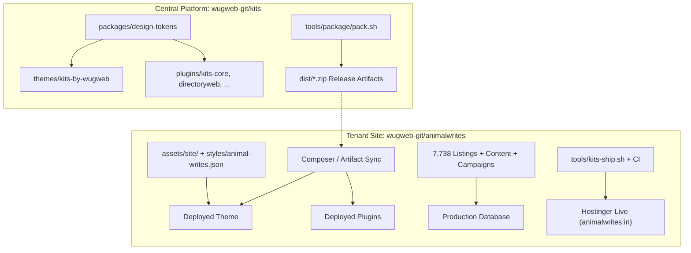

# Animal Writes: Monorepo Migration Inventory & Tenant Decoupling Architecture

> **Context & Purpose**: With the centralization of the **Kits Suite** into the dedicated monorepo (`https://github.com/wugweb-git/kits` on branch `kits-suite`), this document provides a comprehensive accounting of what has been promoted to the central platform versus what remains inside `Animal Writes` (`https://github.com/wugweb-git/animalwrites`), along with the roadmap for complete tenant decoupling.

---

## 1. Executive Summary & Inventory Matrix

| System Component | Central Kits Monorepo (`Kits`) | Animal Writes Repo (`animalwrites`) | Current Status & Role |
| :--- | :---: | :---: | :--- |
| **Theme: `kits-by-wugweb`** | **Master Upstream** | Local Deploy Copy | 100% byte-for-byte synced; Animal Writes deploys it with `assets/site/` overrides |
| **Plugin: `kits-core`** | **Master Upstream** | Local Deploy Copy | Core platform hub: theme options, Foundry sync, token injection, telemetry |
| **Plugin: `directoryweb`** | **Master Upstream** | Local Deploy Copy | Faceted listing engine, search, filter facets, single/archive handlers |
| **Plugin: `rankweb`** | **Master Upstream** | Local Deploy Copy | SEO metadata, breadcrumbs, JSON-LD schema, dynamic sitemaps |
| **Plugin: `mailweb`** | **Master Upstream** | Local Deploy Copy | Transactional mail router, Hostinger API SDK, SMTP/IMAP/POP3 protocols, SPF/DKIM |
| **Plugin: `sourceweb`** | **Master Upstream** | Local Deploy Copy | Ingestion engine, external content scrapers, RSS syndication, API feeds |
| **Plugin: `insightweb`** | **Master Upstream** | Local Deploy Copy | Analytics dashboard, telemetry, engagement metrics |
| **Plugin: `planweb`** | **Master Upstream** | Local Deploy Copy | Editorial calendar, campaign roadmaps, content planning |
| **Foundry Design Tokens** | **Master Upstream** (`packages/design-tokens`) | Synced Baseline | Single source of truth for semantic color/spacing/typography tokens |
| **Packaging & Dist (`pack.sh`)** | **Master Upstream** (`tools/package/`) | N/A (Builds dist locally) | Generates clean distribution ZIPs for all 8 packages |
| **Legacy Caller: `animal-writes-core`** | ❌ Excluded | **Fully Retired (19 Nov 2026)** | Retired in commit `69832857`; `systems.php` moved to site layer (`themes/kits-by-wugweb/assets/site/content/systems.php`), ops moved to `kits-core`, directory moved to `directoryweb`. Zero active footprint on live. |
| **Tenant Site Assets (`assets/site/`)** | ❌ Excluded | **Active in Repo** | Animal Writes logos, SVGs, favicon, custom CSS (`aw-patterns.css`, `aw-site.css`) |
| **Tenant Style Variation** | ❌ Excluded | **Active in Repo** | `themes/kits-by-wugweb/styles/animal-writes.json` (Animal Writes brand palette) |
| **Tenant Templates (`aw_listing`, campaigns)** | ❌ Excluded | **Active in Repo** | Indian animal directory templates, `/lab/`, `/diwali/`, `/sc/` campaigns |
| **Tenant Content Scrapers & LGD Data** | ❌ Excluded | **Active in Repo** | `tools/content/`, `tools/directory/`, `tools/lgd/` (India Local Government Directory) |
| **Hostinger Server Deploy Pipeline** | ❌ Excluded | **Active in Repo** | `tools/kits-ship.sh`, `tools/ci/`, Hostinger SSH deploy runner |

---

## 2. What Remains in `Animal Writes` (Detailed Breakdown)

### A. Legacy Caller / Bridge Plugin Status
* **`animal-writes-core` — FULLY RETIRED & DECOMMISSIONED (19 Nov 2026, commit `69832857`)**:
  - The plugin directory `plugins/animal-writes-core/` was permanently deleted in commit `69832857` (1,490 lines removed).
  - `git merge-base --is-ancestor 69832857 origin/wordpress` confirms it has been live and promoted since Nov 19.
  - Where the responsibilities moved:
    - **Site systems & content bindings**: Moved to the site layer at `themes/kits-by-wugweb/assets/site/content/systems.php`.
    - **Content types, presets & ops**: Moved to `plugins/kits-core/` (presets, cron stats, 404 tracking, deploy purge hooks).
    - **Directory & Listings**: Moved to `plugins/directoryweb/`.
    - **`aw-keys` vault**: Permanently retired; each plugin now manages its own credentials directly.
  - On the live server (`animalwrites.in`), `wp plugin list --status=active` confirms `animal-writes-core` is zero-footprint (not active, not installed).

### B. Visual Tokens & Brand Overrides
* **`themes/kits-by-wugweb/assets/site/`**:
  * Brand iconography: `aw-logo.svg`, `aw-logo-dark.svg`, `aw-mark.svg`, `favicon.ico`, social preview cards.
  * Site-specific stylesheets: `aw-patterns.css`, `aw-site.css` (custom campaign rules, hero gradients, Indian animal law typography accents).
* **`themes/kits-by-wugweb/styles/animal-writes.json`**:
  * Theme style variation registering the Animal Writes palette (`#c15a3a` terracotta accent, forest green, warm slate, bone cream background).

### C. Site-Specific Templates & CPT Implementations
* **Custom Templates**:
  * `themes/kits-by-wugweb/templates/archive-aw_listing.html` (Faceted directory index for India shelters/vets).
  * `themes/kits-by-wugweb/templates/single-aw_listing.html` (Single directory detail listing).
  * Specialized campaign landing pages:
    * `/lab/`: Campaign against regulatory animal testing in Indian cosmetic/pharma laboratories.
    * `/diwali/`: Animal welfare and noise safety guidelines during Diwali.
    * `/sc/`: Indian Supreme Court legal precedents and PIL case tracker.

### D. Tenant Data, Scraping, Normalization & Analytics
* **`tools/directory/`**:
  * Data processing and geocoding scripts for 7,738 verified listings across 28 Indian states and 8 union territories.
* **`tools/lgd/`**:
  * India Local Government Directory mapping tables (State, District, Sub-district LGD codes) ensuring directory taxonomy complies with Indian administrative boundaries.
* **`tools/content/`**:
  * Ingestion parsers for the Prevention of Cruelty to Animals (PCA) Act 1960, Wildlife Protection Act (WPA) 1972, Animal Birth Control (ABC) Rules 2023, and landmark legal orders.
* **`tools/awbi/`**:
  * Animal Writes Business Intelligence analytics, directory health audits, verification metrics.
* **`forms/`**:
  * Public cruelty reporting schemas, shelter verification claim forms, community submission JSONs.

### E. Production Hosting, CI Gates & Deployment Pipeline
* **`tools/kits-ship.sh`**:
  * Production gating script ensuring `deploy-check.yml` passes before promoting `wordpress-dev` to `wordpress`.
* **`tools/ci/`**:
  * 46 automated CI check scripts:
    * `mail_sending_check.py` (FluentCRM safety guard).
    * `check_campaign_home_contrast.py` (WCAG AAA contrast audit).
    * `check_no_duplicate_pictures.py` (editorial asset integrity).
    * `check_site_files.py` (verifies `assets/site/` integrity).
* **Server Target**:
  * Hostinger VPS environment (`u544169507@46.28.45.135`), LiteSpeed page cache purge hooks, production MySQL database.

---

## 3. Decoupling Roadmap: Transitioning to Pure Consumer

To finalize the separation between the **Wugweb Platform** and the **Animal Writes Tenant**:

### Action Items for Complete Tenant Separation:
1. **Move Animal Writes Overrides Out of Theme Core**:
   * Relocate `assets/site/` and `styles/animal-writes.json` into a tenant child theme or configure them via the `kits-core` tenant asset loader (`wp_theme_json_data_theme` filter).
2. **Package Ingestion**:
   * In `animalwrites`, consume the theme and 7 plugins as versioned release ZIPs or Git subtrees from `wugweb-git/kits`.
3. **Decommission `animal-writes-core`**:
   * Migrate any lingering database schema definitions to standard `directoryweb` custom field registrations.
