# Block Theme & Companion Plugins Master Architecture Plan

**Product:** Kits by Wugweb (FSE Block Theme) & Wugweb Suite (Modular Plugins)  
**Date:** 21 November 2026  
**Auditor & Architect:** WordPress Core / FSE Architect & Gutenberg Specialist  
**Standards Compliance:** WordPress 6.6 / 6.7 Block Theme Handbook & Gutenberg Standards  

---

## 1. Executive Status & Live Environment

* **Site Breakdown & Collisions Resolved:** Colliding plugin `amp-wp` and interfering `business-directory-plugin` have been deactivated. Verified all 7,738 directory listings (`aw_listing`) remain 100% intact.
* **Code State:** Live production and `wordpress-dev` have been reset to the exact state of Claude's PR #170 release (`4151ad25`), verified via SSH and deployed commit `c8d56b34`.
* **Frontend Performance:** All 10 audited page types return HTTP 200 OK with zero unrendered shortcodes and active LiteSpeed dynamic caching.

---

## 2. Comprehensive Page-by-Page Block Audit

A live DOM and template inspection of every key page type was conducted to assess adherence to WordPress Block Theme guidelines:

| Page Type | Live URL | wp-block Count | Template File | Gutenberg Block Adherence Status |
|---|---|---|---|---|
| **Front Page** | `/` | 278 | `assets/site/templates/front-page.html` | **Partial**: Uses native template parts and block patterns, but `find-help.php` embeds `[aw_find_help]` and `newsletter.html` embeds `[aw_newsletter]`. |
| **Directory Hub** | `/directory/` | 189 | `assets/site/templates/page-hub.html` | **Good**: Renders `<!-- wp:post-content /-->` wrapped in layout-constrained group. Listing grid is dynamic. |
| **Listing Profile** | `/directory/org/nawabi-tails-rescue/` | 80 | `assets/site/templates/single-aw_listing.html` | **Hybrid**: Structured with `wp:group` and `wp:rankweb/breadcrumbs`, but mixes 18 dynamic `animal-writes/*` blocks with `[aw_org_people]` and `wp:advads/gblock`. |
| **Library Hub** | `/library/` | 210 | `assets/site/templates/page-hub.html` | **Good**: Full block container with dynamic filtering and card grid. |
| **Library Single** | `/library/draft-laboratory-animals-rules-2026/` | 363 | `assets/site/templates/single.html` | **Excellent**: Pure block rendering (`core/post-title`, `core/post-featured-image`, `core/post-content`). |
| **News Hub** | `/news/` | 160 | `assets/site/templates/page-hub.html` | **Good**: Pure block container with mosaic card grid. |
| **Campaigns Hub**| `/campaigns/` | 99 | `assets/site/templates/page-hub.html` | **Good**: Block grid displaying active and archived campaigns. |
| **Campaign Single**| `/lab/` | 244 | `assets/site/templates/campaign-page.html`| **Mixed**: Pure `<!-- wp:post-content /-->` container, but campaign content uses legacy shortcodes (`[aw_countdown]`, `[aw_letter_tool]`). |
| **Volunteer** | `/volunteer/` | 81 | `assets/site/templates/page-volunteer.html`| **Good**: Structured with core columns, buttons, and form container. |
| **About Page** | `/about/` | 184 | `assets/site/templates/page.html` | **Excellent**: Native block content (`core/heading`, `core/paragraph`, `core/columns`). |

---

## 3. Structural Gaps Against Gutenberg Block Theme Rules

### 3.1 Legacy Shortcodes Embedded in Block Templates
In a pure Block Theme, templates (`.html`) and template parts must not rely on `<!-- wp:shortcode -->` or raw shortcode strings:
1. `newsletter.html`: Outputs `<div class="kit-nl-band-form kit-ico--mail">[aw_newsletter]</div>` instead of native `<!-- wp:mailweb/newsletter /-->`.
2. `find-help.php` (Home Pattern): Embeds `[aw_find_help compact="1"]` inside `wp:shortcode`.
3. `single-aw_listing.html`: Embeds `[aw_org_people]` inside `wp:shortcode`.
4. `category.html`: Embeds `[aw_category_hub]` inside `wp:shortcode`.
5. `404.html`: Embeds `[aw_not_found]` inside `wp:shortcode`.
6. `campaign.php`: Embeds `[aw_countdown]` inside `wp:shortcode`.

### 3.2 Monolithic Dynamic Blocks vs WordPress Block Bindings API
Currently, 30+ dynamic blocks are registered in `hub-blocks.php` under `animal-writes/*` via PHP render callbacks (`register_block_type`).  
* **Modern Best Practice (WP 6.5+):** Instead of creating black-box custom blocks for every single field, core blocks (`core/heading`, `core/paragraph`, `core/post-featured-image`) should use the **Block Bindings API** (`metadata.bindings`) connected to `kits/post-field`. This enables full visual editing in the Site Editor while keeping markup 100% native.

### 3.3 Third-Party Block Coupling in Theme Templates
`single-aw_listing.html` directly references `<!-- wp:advads/gblock {"itemID":"place_profile"} /-->`. If Advanced Ads is deactivated or absent in a commercial/marketplace context, WordPress flags an unregistered block error.

---

## 4. Master Architecture Plan: Pure Block Theme & Companion Plugins

```mermaid
graph TD
    subgraph "Pure Block Theme (themes/kits-by-wugweb)"
        TJ["theme.json (v3)<br/>Typography, Spacing Tokens, Color Palette"]
        TP["Templates (.html)<br/>index, front-page, single, archive, 404"]
        PARTS["Template Parts (.html)<br/>header, footer, newsletter, sidebar"]
        PATTERNS["Block Patterns (patterns/*.php)<br/>Handbook Headers: Block Types, Categories"]
    end

    subgraph "Companion Plugin Suite"
        KC["Kits Core<br/>Bindings Engine (kits/post-field), Onboarding Wizard, Shell"]
        DW["DirectoryWeb<br/>directoryweb/map, directoryweb/search, listing CPT"]
        RW["RankWeb<br/>rankweb/breadcrumbs, Editor Sidebar, Schema Engine"]
        MW["MailWeb<br/>mailweb/newsletter, FluentCRM Form Handlers"]
        SW["SourceWeb<br/>Attribution, News Sync, CC0 Image Sourcing"]
        IW["InsightWeb<br/>GTM/GA4 Context, Clarity Telemetry, Keyword Intel"]
        PW["PlanWeb<br/>Editorial Calendars, Task Automation"]
    end

    subgraph "Gutenberg Site Editor"
        SE["Native WordPress Site Editor<br/>Full Visual Control, Zero Shortcodes, Zero Monolithic PHP Blocks"]
    end

    TJ --> SE
    TP --> SE
    PARTS --> SE
    PATTERNS --> SE
    KC -->|Provides Bindings & Shell| SE
    DW -->|Provides Native Blocks| SE
    RW -->|Provides Native Blocks| SE
    MW -->|Provides Native Blocks| SE
```



### 4.1 Phase 1: Shortcode Elimination & Native Block Conversion
1. **Convert `[aw_newsletter]`:** Update `themes/kits-by-wugweb/assets/site/parts/newsletter.html` to output native `<!-- wp:mailweb/newsletter {"layout":"card"} /-->`.
2. **Convert `[aw_find_help]`:** Register native Gutenberg block `directoryweb/search` with interactive attributes (`compact`, `showLocation`, `stateFilter`) and update `find-help.php`.
3. **Convert `[aw_countdown]`:** Register native block `kits/countdown` or provide block variation.
4. **Convert `[aw_org_people]`:** Register native block `directoryweb/team` or convert to Block Bindings repeater.

### 4.2 Phase 2: Block Bindings Migration for Single Templates
Replace monolithic `animal-writes/listing-*` dynamic blocks in `single-aw_listing.html` with native core blocks using WordPress Block Bindings:
```html
<!-- Example: Native Gutenberg Heading with Block Binding -->
<!-- wp:heading {"level":1,"metadata":{"bindings":{"content":{"source":"kits/post-field","args":{"key":"aw_display_name"}}}}} -->
<h1 class="wp-block-heading">Organisation Name</h1>
<!-- /wp:heading -->

<!-- Example: Native Gutenberg Paragraph with Block Binding -->
<!-- wp:paragraph {"metadata":{"bindings":{"content":{"source":"kits/post-field","args":{"key":"aw_phone"}}}}} -->
<p>+91 98765 43210</p>
<!-- /wp:paragraph -->
```

### 4.3 Phase 3: Marketplace & Directory Separation
1. **Clean Theme Separation:** Ensure `themes/kits-by-wugweb/` contains zero hardcoded tenant terms (`Animal Writes`, `aw_`). All tenant-specific customizations reside in `assets/site/` or through user-configured Site Editor templates.
2. **Graceful Block Fallbacks:** Wrap sponsored/ad slots in conditional comment wrappers or dynamic block registrations that degrade cleanly when third-party plugins are disabled.
3. **Plugin Check (PCP) & WPCS Compliance:** Maintain 0 PHPCS errors, 0 translation warnings, and 0 Plugin Check blockers across all 7 companion plugins.
