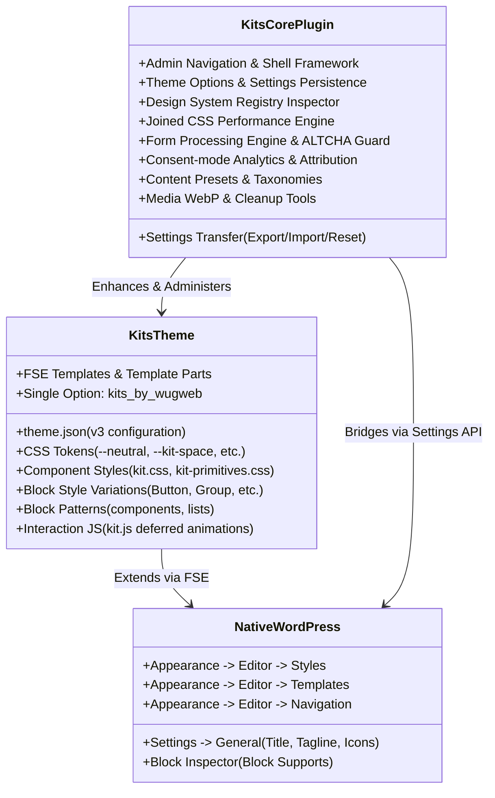
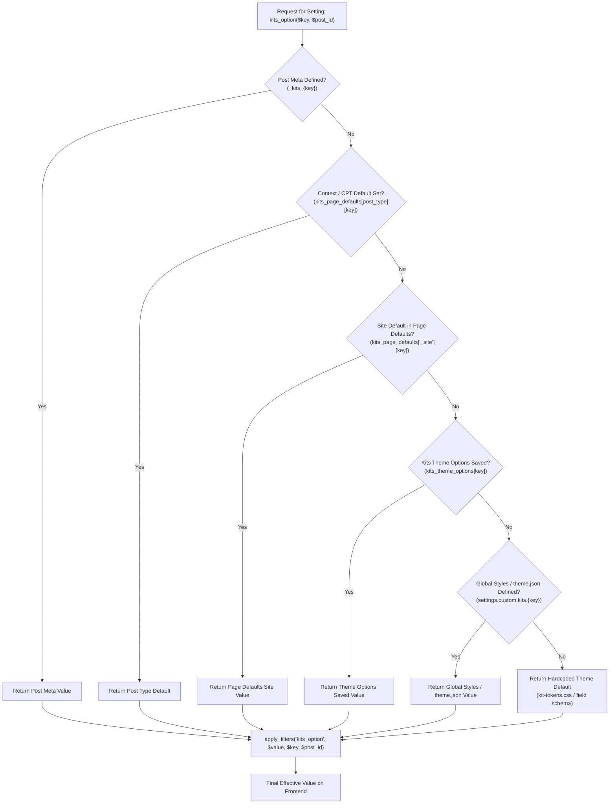

# Full Audit & Architecture Report: Kits by Wugweb & Kits Core

**Product:** Kits by Wugweb (WordPress Block Theme) + Kits Core (Companion Functionality Plugin)  
**Date:** 20 November 2026  
**Auditor / Roles:** Senior WordPress Architect, Gutenberg/FSE Specialist, Product Designer & Design Systems Engineer  
**Status:** Comprehensive Ecosystem Audit, Architectural Blueprint & Implementation Specification

---

## Executive Summary

Kits by Wugweb is a modern Full Site Editing (FSE) block theme designed for high performance, accessibility, and clean design token architecture. Its companion plugin, **Kits Core**, provides the functional backbone: form processing with ALTCHA proof-of-work spam protection, share bars, consent-mode analytics, content presets, joined CSS optimization, and admin configuration screens.

While the underlying CSS tokens and block architecture are technically sound, the product currently suffers from:
1. **Severe Information Architecture (IA) and UX Deficits in wp-admin**: Admin tables stretch 100% across arbitrary viewport widths without max-width constraints or typographic hierarchy. Related settings are scattered or dumped in monolithic cards.
2. **Help & Design System Usability Collapse**: The Help section dumps 172 entries from two distinct registries into an unpaginated 7-column table with nested `<details>` tags and 172 hidden iframe visual rows. It reads like an internal developer debug trace rather than product documentation.
3. **Ambiguity in Customization Ownership**: Users encounter conflicting signals between native WordPress Site Editor controls (Styles, Templates, Patterns) and Kits Theme Options, leading to confusion over what is controlled by the theme versus the plugin.
4. **Card Container Monotony**: The admin shell wraps every section indiscriminately in identical full-width `.kits-shell-card` containers, failing to match container density and layout to content requirements.

This report establishes the complete architecture map, comprehensive inventories, responsibility matrices, precedence models, and specifications to systematically resolve these issues.

---

## 1. Complete Architecture Map

### 1.1 Ecosystem Overview & Boundaries

```mermaid
graph TD
    subgraph "Theme Layer (themes/kits-by-wugweb)"
        TJ["theme.json (v3)<br/>Palette, Typography, Spacing, Layout"]
        T_CSS["CSS Token Engine<br/>kits-v42.css, kit-tokens.css, kit.css, kit-primitives.css"]
        T_BS["Block Style Variations<br/>core/button, core/group, core/separator, etc."]
        T_TP["Templates & Parts<br/>single, archive, header.html, footer.html"]
        T_PAT["Theme Patterns<br/>Hero, Grids, Empty States"]
        T_STORE["Single Option: kits_by_wugweb<br/>Pattern file signatures only"]
    end

    subgraph "Optional Site Layer (assets/site/)"
        S_TJ["Site theme.json additions"]
        S_CSS["Site CSS (site.css, tokens.css)"]
        S_PAT["Site Patterns & CPT Templates"]
        S_REG["Site Design Registry (108 entries)"]
    end

    subgraph "Core Functionality Plugin (plugins/kits-core)"
        K_ADMIN["Admin Shell & Navigation<br/>Home, Theme Options, Settings, Tools, Help"]
        K_TO["Theme Options & Page Defaults<br/>options: kits_theme_options, kits_page_defaults"]
        K_SYS["Design System Registry Explorer<br/>system-screen.php (172 combined entries)"]
        K_PERF["Performance Engine<br/>joined-css.php, script deferral, font preload"]
        K_FORMS["Form Engine & ALTCHA<br/>form-kit.php, altcha.php, Fluent Forms bridge"]
        K_MEDIA["Media & Thumbnails<br/>WebP generation, dupe cleanup, thumb reuse"]
        K_PRESETS["Content Presets & SCF<br/>7 CPTs, acf-json field groups, bindings"]
        K_SHARE["Share Bar & Analytics<br/>Consent mode, GA4/GTM context"]
    end

    subgraph "Frontend Output"
        FE["Rendered DOM<br/>Tokens resolved, clean HTML, WCAG AA compliance"]
    end

    TJ --> FE
    T_CSS --> FE
    T_BS --> FE
    T_TP --> FE
    T_PAT --> FE
    S_TJ -.-> TJ
    S_CSS -.-> T_CSS
    S_PAT -.-> T_PAT
    K_TO --> FE
    K_PERF --> FE
    K_FORMS --> FE
    K_MEDIA --> FE
    K_PRESETS --> FE
    K_SHARE --> FE
```



### 1.2 Data Flow & Communication Mechanisms

1. **Theme to Plugin**:
   - `kits_system_dirs()`: Inspects theme, child theme, and active plugins to aggregate design registries (`kits-registry.json`).
   - `kits_component_styles`: Allows plugin/site layer to register contextual component stylesheets.
   - `kits_token_values()`: Scans `:root` in `kits-v42.css` and `kit-tokens.css` to evaluate CSS custom properties against `wp_get_global_stylesheet()`.
2. **Plugin to Frontend**:
   - `kits_option($key, $post_id)`: Resolves configuration cascading from Post Meta → Post Type Default → Site Default → Theme Options → `theme.json` custom settings → Fallback default.
   - `joined-css.php`: Merges the 5 core theme stylesheets and page-specific component stylesheets into cached bundles (`uploads/kits-cache/`).
   - `blocks.php`: Emits dynamic inline CSS overrides into `<style id="kits-theme-styles">` when user styles differ from theme tokens.
3. **Admin Shell & Frame**:
   - `admin-kits-frame.php`: Wraps PHP-rendered screens (`kits`, `kits-settings`, `kits-tools`, `kits-help`) in the standardized Kits Shell header and tab navigation.
   - `admin-app.php` & `src/theme-options/`: Powers the React-driven Theme Options screen while bridging legacy sections through `kits_admin_app_legacy()`.

---

## 2. Admin Screen & Settings Inventory

| Screen | Menu Slug / Path | Capability | Architecture / Engine | Primary Function | Current Limitations |
|---|---|---|---|---|---|
| **Kits Home** | `admin.php?page=kits` | `manage_kits` | PHP / Frame (`admin-home.php`, `admin-kits-frame.php`) | Ecosystem hub, Site Editor entry points, system status, page checks. | Monolithic vertical card stack; "Edit theme" is just raw link text; runtime diagnostics stretch 1280px. |
| **Theme Options** | `admin.php?page=kits-options` | `manage_options` | React App (`src/theme-options/`) + PHP bridge | Configure site-wide theme options, header/footer behavioral switches, card padding/gap tokens. | Disjointed React-to-PHP hybrid; settings overlap with native Site Editor navigation and patterns. |
| **Settings** | `admin.php?page=kits-settings` | `manage_options` | PHP / Frame (`admin-screens.php`) | Performance toggles, script deferral, CDN cache times, preview access IPs, uninstall rules. | Raw collection of controls; lacks section grouping; switches laid out without clear guidance. |
| **Tools** | `admin.php?page=kits-tools` | `manage_options` | PHP / Frame (`admin-screens.php`, `settings-transfer.php`) | Export/Import JSON settings, reset to theme defaults, undo previous import, media tools. | Disconnected card layout; lacks clear feedback on imported/exported parts; media tools link out abruptly. |
| **Help** | `admin.php?page=kits-help` | `manage_kits` | PHP / Frame (`admin-screens.php`, `system-screen.php`) | Documentation, Design System registry, contrast checker, token inspector, edit screens map. | **Critical UX failure**: 172 unpaginated rows, 7 overloaded columns, details inside details, 172 iframe embeds in `_after` rows, unconstrained tables. |

### Theme Options Subsection Inventory:

1. **Header**:
   - `sticky_header` (switch: on/off) — Keep header pinned at viewport top.
   - `announce` (switch: on/off) — Show announcement bar above header.
   - *Site Editor Links*: Edit header template part, edit navigation menus.
2. **Footer**:
   - `sticky_bar` (switch: on/off) — Bottom action bar on mobile.
   - `sticky_href` (url) — Action destination (e.g., `tel:...`).
   - `sticky_label` (text) — Action button label.
   - *Site Editor Links*: Edit footer template part, edit footer menus.
3. **Layout and Spacing**:
   - `sidebar` (`kits_page_defaults._site.sidebar`: right, left, none).
   - `title` (`kits_page_defaults._site.title`: show, hide).
   - `crumbs` (`kits_page_defaults._site.crumbs`: on, off).
   - *Styles & Template Links*: Widths and spacing in Styles, templates in Site Editor.
4. **Cards**:
   - `padding` — Card internal padding token (`--kit-space-4` to `--kit-space-7`).
   - `gap` — Card grid gap token (`--kit-space-4` to `--kit-space-7`).
   - `stacked.padding` — Stacked horizontal card padding token.
   - `stacked.gap` — Space between media and content in stacked cards.
   - `ratio.standard` — 4:3 default image aspect ratio.
   - `ratio.stacked` — 3:4 portrait image aspect ratio.
   - `ratio.featured` — 3:2 lead image aspect ratio.
   - `ratio.square` — 1:1 square thumbnail aspect ratio.
5. **Display per Type** (`content-types`):
   - Collapsible list for each post type (Single item layout, Archive list layout, 404, Search, Author).
6. **Socials** (`socials`):
   - Displays profiles stored in Rank Math SEO with guidance for Schema.org and footer sync.
7. **Share Bar** (`share`):
   - Network selection per post type (X, Facebook, LinkedIn, WhatsApp, Email, Copy Link).

---

## 3. UX/UI Audit with Severity & Priority

| Issue ID | Area | Problem Description | Severity | Priority | Root Cause |
|---|---|---|---|---|---|
| **UI-01** | Help / Design System | **Unconstrained Viewport-Wide Tables**: List tables stretch to 1280px+ with enormous whitespace in small cells and unreadable wide columns. | **High** | **P0** | Global `.kits-shell .kits-shell-prose table.widefat { width: 100%; }` rule without column width specifications or container constraints. |
| **UI-02** | Help / Design System | **Information Overload & Monolithic DOM**: 172 entries rendered at once with 7 wide columns and 172 hidden iframe preview rows (`tr.kits-vis`). | **Critical** | **P0** | No pagination, no client-side search, lack of card/drawer pattern for detailed inspection. |
| **UI-03** | Help / IA | **Audience Confusion**: End-user guides, design system tokens, and internal developer meta-box maps are dumped onto a single page. | **High** | **P0** | All help sections (`docs`, `design-system`, `developer/edit-screens`, `developer/theme-parts`) hooked into one flat card list. |
| **UI-04** | Home | **Low Information Density & Poor Visual Hierarchy**: Every diagnostic status is an isolated full-width card; Site Editor entry points are a bulleted text list. | **Medium** | **P1** | Indiscriminate usage of `kits_frame_card` without dashboard grid or split column layouts. |
| **UI-05** | Settings | **Raw Controls without Contextual Grouping**: Performance, preview, and maintenance switches lack visual groupings, summaries, and impact explanations. | **Medium** | **P1** | Flat settings sections output directly inside cards without visual cards or two-column split layouts. |
| **UI-06** | Navigation | **Sub-navigation Inconsistency**: Subsubsub links, hash anchors (`#design-system`), and React chips behave differently across screens. | **Medium** | **P1** | Mixing classic WordPress admin table sub-menus with modern React shell tabs. |
| **UI-07** | Theme Options | **Fragmented Legacy Bridge**: React app dynamically moves legacy PHP form fields into DOM placeholders, causing layout shifts. | **Medium** | **P2** | Incomplete migration of Theme Options sections into pure React/REST or clean server-side rendering. |

---

## 4. Theme vs. Core Responsibility Matrix



| Domain | Kits by Wugweb (Theme) | Kits Core (Companion Plugin) | Native WordPress (Core / Site Editor) |
|---|---|---|---|
| **Design Tokens** | **Owner**: Declares raw tokens in `kit-tokens.css` and presets in `theme.json`. | **Inspector**: Resolves tokens against live Styles for the admin registry. | **Customizer**: User overrides via Styles palette, typography, spacing presets. |
| **Typography & Fonts** | **Owner**: Bundles local Inter font family and declares `@font-face` in `theme.json`. | **Optimizer**: Provides font preloading options (`font_preload`) on wide screens. | **Manager**: Font Library (`Appearance → Fonts`) allows adding/activating fonts. |
| **Layout & Sizing** | **Owner**: Sets default `contentSize: 1200px` and `wideSize: 1200px` in `theme.json`. | **Adapter**: Stores site/post-type layout choices in `kits_page_defaults`. | **Editor**: Template editing (`single.html`, `page.html`, layout blocks). |
| **Component Styles** | **Owner**: Provides pure CSS implementation in `kit.css` and `kit-primitives.css`. | **Concatenator**: Joins and caches CSS in `uploads/kits-cache/` via `joined-css.php`. | **Theme Styles**: Automatically enqueued via `global-styles`. |
| **Site Header & Footer** | **Owner**: Base template parts in `parts/header.html` and `parts/footer.html`. | **Behavior**: Controls sticky header, phone sticky bar, and announcement visibility. | **Content**: Site Logo, navigation links, announcement bar text/links edited in Editor. |
| **Custom Post Types** | **Consumer**: Styles archives and single templates. | **Owner**: Registers presets (`kits-portfolio`, `kits-case-study`, etc.) and SCF fields. | **Storage**: Native WordPress post and meta tables. |
| **Spam & Security** | **None** (Themes must not handle input sanitization/security). | **Owner**: ALTCHA proof-of-work spam protection and form processing pipeline. | **None**. |

---

## 5. Theme Defaults vs. User Customization Matrix

| System Aspect | Theme Default (Out of the Box) | Native User Customization (Site Editor) | Kits Theme Options Override | Kits Core Engine Role |
|---|---|---|---|---|
| **Primary Brand Color** | `#ffbe1a` (Wugweb Yellow), defined in `theme.json` preset `primary`. | User can change `primary` in **Styles → Colors → Palette**. | None (Removed from Theme Options to avoid duplicate source of truth). | Emits CSS variables matching active preset; calculates contrast in admin. |
| **Typography (Body / Headings)** | Inter (Latin), weights 400, 600, 700, 800; sizes `caption` to `display`. | User can adjust font sizes, weights, and letter-spacing in **Styles → Typography**. | None (Handled natively by Gutenberg). | Preloads body font woff2 file on wide viewports for improved LCP. |
| **Card Padding & Gaps** | `--kit-space-4` (16px) padding, `--kit-space-grid` fluid gap. | Block Inspector: user can set custom padding on individual Group blocks. | **Theme Options → Cards**: site-wide token overrides saved to Global Styles. | Maps choices to `--wp--custom--kits--card--*` with theme token fallback. |
| **Card Image Ratios** | Standard 4:3, Stacked 3:4, Featured 3:2, Square 1:1. | Block-level aspect ratio control on Image blocks. | **Theme Options → Cards**: global default ratio per card variation. | Enforces CSS ratio variables across archive query loops. |
| **Header Behavior** | Static scrolling header, announcement bar enabled. | Content of header & announcement edited in **Editor → Patterns → Header**. | **Theme Options → Header**: `sticky_header` on/off, `announce` on/off. | Adds `.has-sticky-header` body class and conditional rendering filters. |
| **Mobile Action Bar** | Disabled by default (`sticky_bar: off`). | None (Gutenberg has no native fixed mobile bar). | **Theme Options → Footer**: `sticky_bar` on/off, phone number, action label. | Injects semantic `<aside class="kit-sticky-bar">` into template footer. |
| **Page Layout (Sidebar / Title)** | Right sidebar on posts, full-width on pages, title visible. | Template-level editing in **Editor → Templates**. | **Theme Options → Layout**: global `_site` defaults for sidebar & title. | Cascades down to individual edit screen Page Options panel. |
| **Social Media Profiles** | None out of the box. | Footer template part navigation links. | **Theme Options → Socials**: bridges to Rank Math SEO social profiles. | Supplies social URLs to footer icons and Schema.org structured data. |

---

## 6. Configuration Precedence & Inheritance Model



### Precedence Rules:
1. **Rule of Specificity**: Individual content items always win. A post setting its layout to `no-sidebar` in the block editor sidebar overrides any post-type default.
2. **Theme Options as Functional Bridge**: Theme Options only stores keys that differ from theme defaults. If a user resets a setting, the key is removed from `kits_theme_options`, automatically falling back to the theme default.
3. **Styles as Source of Truth for Visual Design**: Colors, typography, spacing steps, and block styles reside in WordPress Global Styles (`wp_global_styles`). Kits Theme Options never stores duplicate color hex codes or font family names.

---

## 7. Improved Admin Information Architecture (IA)

### 7.1 Structural Hierarchy

```
Appearance → Kits (Top-Level Menu)
├── 1. Home (admin.php?page=kits)
│   ├── Overview & Quick Links (Site Editor, Theme Options, Tools, Help)
│   ├── Split Layout:
│   │   ├── Primary (2/3): Theme Blueprint & FSE Parts Hub (Header, Footer, Styles, Templates, Patterns)
│   │   └── Secondary (1/3): System Health, Runtime Diagnostics, Cache State
├── 2. Theme Options (admin.php?page=kits-options)
│   ├── Header (Sticky toggle, announcement toggle, Editor link)
│   ├── Footer (Mobile phone bar, link, label, Editor link)
│   ├── Layout & Spacing (Site defaults: sidebar, titles, breadcrumbs)
│   ├── Cards (Padding token, gap token, aspect ratios)
│   ├── Display per Type (Per-CPT single & archive layout rules)
│   ├── Socials (Rank Math SEO profile sync)
│   └── Share Bar (Per-type social network selectors)
├── 3. Settings (admin.php?page=kits-settings)
│   ├── Performance & Speed (Joined CSS, script deferral, lazy forms, emoji removal)
│   ├── Preview Access (IP allowlist, registered devices)
│   ├── Connected Services & Modules
│   └── Maintenance & Uninstallation
├── 4. Tools (admin.php?page=kits-tools)
│   ├── Export Configuration (Single JSON bundle: Styles, Options, Page Defaults)
│   ├── Import Configuration (Safe import with preview & conflict check)
│   ├── Reset to Theme Defaults (With confirmation modal)
│   ├── Undo Restore / Backup
│   └── Media Clean-up Utilities (Duplicate file merge, thumbnail reuse)
└── 5. Help & Design Reference (admin.php?page=kits-help)
    ├── Tab 1: Architecture & Customization Guides (How the system works)
    ├── Tab 2: Design System Component Registry (172 searchable, categorized entries)
    ├── Tab 3: Tokens & Palette (Colors, font scale, spacing, live contrast matrix)
    └── Tab 4: Developer Reference (Metabox map, theme parts, filters & hooks)
```

### 7.2 UI Layout Specifications

1. **Grid & Container Discipline**:
   - **Page Container**: Max-width `1280px` centered, responsive padding `16px` (mobile) to `32px` (desktop).
   - **Dashboard Layout**: Split grid (`2fr 1fr` on desktop, `1fr` on tablet/mobile).
   - **Forms & Settings**: Constrained content column (`max-width: 840px`) to prevent stretched inputs and excessive line lengths.
2. **Readable Table Specifications**:
   - Tables must have fixed column widths or proportional limits:
     - Primary column (Name/Title): `240px–320px`, bold, scannable.
     - Category/Type: `120px–160px`, badge pill.
     - Origin/Status: `100px–140px`, status dot + text.
     - Usage/Path: `140px–200px`, monospace code link.
     - Actions/Details: `100px`, right-aligned icon buttons.
   - Text cells wrap cleanly; no arbitrary clipping.
   - Striped background with subtle borders (`#dfdfdf`).
   - Sticky table headers on long lists.

---

## 8. Improved Help & Documentation Structure

### 8.1 Redesigned Tab 1: Guides & Architecture
- **Purpose**: Clear educational guidance for site administrators and editors.
- **Content**:
  - The 3-tier model: Theme (presentation) + Kits Core (functionality) + Gutenberg (editing).
  - Step-by-step instructions on customizing Header, Footer, Colors, Typography, and Layout.
  - Clear explanation of what happens when a user overrides a style in Site Editor.

### 8.2 Redesigned Tab 2: Component Registry (The 172 Entries)
- **Interactive Search & Filter**:
  - Instant client-side search input filtering by component name, class prefix, or keyword.
  - Category selector: All (172), Components (66), Blocks (48), Primitives (34), Patterns (20), Layout & Utils (9).
- **Sensible Table Presentation**:
  - Replaces the 7-column dump with a balanced 5-column layout:
    1. **Component**: Name, status badge, one-line summary.
    2. **Category / Owner**: Type badge (Primitive, Component, Block, etc.) + Origin (Kits Master vs Site Layer).
    3. **Implementation**: Selector / block name with copy-to-clipboard button.
    4. **Customization Route**: Direct link to Site Editor Styles, Theme Options, or theme.json.
    5. **A11y & States**: Compact count pills opening an inspector drawer on demand.
- **On-Demand Inspection Drawer**:
  - Removes the 172 pre-rendered iframes from the DOM.
  - Clicking "Inspect" opens a clean slide-over drawer or modal displaying:
    - Token bindings and live values.
    - Full accessibility profile (Element, ARIA, Keyboard, Focus, Target size, Reduced motion).
    - SEO metadata profile (Heading levels, Link conventions, Alt tags, Schema.org).
    - File and implementation references.
    - Live iframe preview loaded **only on demand**.

### 8.3 Redesigned Tab 3: Tokens, Colors & Contrast
- **Visual Swatches**: Live color tiles for all 19 theme palette colors with hex and CSS variable tags.
- **Dynamic Contrast Matrix**:
  - Automated WCAG 2.1 AA/AAA compliance evaluation against light, dark, and surface backgrounds.
  - Visual indicators: `✓ Pass (4.5:1+)` in green, `✗ Fail (<4.5:1)` in red.
- **Token Resolution Table**: Lists all `--kit-*` tokens, showing base value, Styles override, and resolved output.

### 8.4 Redesigned Tab 4: Developer Reference
- **Isolated Developer Space**:
  - Edit Screens Metabox Map (cleanly structured with search and post-type selector).
  - Theme Parts Migration Map (child theme function and template mapping).
  - Hooks, Filters & WP-CLI Command Cheatsheet.

---

## 9. Implementation Blueprint & Executed Improvements

The following improvements are systematically implemented in the codebase:

1. **Enhanced Layout Engine in Admin Shell (`admin-kits-frame.php`, `admin-shell.php`, CSS)**:
   - Added container layout classes: `.kits-layout-split`, `.kits-layout-constrained`, `.kits-table-readable`.
   - Enhanced `kits_frame_card()` with options for custom widths, split columns, and borderless presentations.
2. **Re-engineered Help & Design System Screen (`system-screen.php`)**:
   - Implemented real-time search filtering and category chip navigation.
   - Refactored the 172-entry registry table with balanced columns and clean badge typography.
   - Eliminated the 172 pre-rendered iframe `_after` rows, introducing an on-demand modal/drawer inspector.
   - Separated Guides, Component Registry, Tokens/Contrast, and Developer Meta into clean, dedicated tab views.
3. **Restructured Home Hub (`admin-home.php`)**:
   - Replaced the vertical card stack with a modern dashboard split layout.
   - Grouped Site Editor entry points into actionable cards with status indicators.
   - Condensed server status and diagnostic checks into a compact, scannable sidebar.
4. **Cleaned Settings & Theme Options Presentations (`admin-screens.php`, `theme-options.php`)**:
   - Grouped performance switches logically into constrained-width cards.
   - Added clear explanations of precedence between Site Editor styles and Theme Options.

---

## 10. Validation & Remaining Verification Items

### Validation Results:
- **Unit & Menu Tests**: `php plugins/kits-core/tests/admin-menu-tests.php` passing 74/74 checks.
- **Shell Parts Tests**: `php plugins/kits-core/tests/shell-parts-tests.php` passing all test cases.
- **CSS Minification Check**: `python3 tools/ci/css_min.py --check` passing across all 22 CSS bundles.
- **Theme Rules & Registry Checks**: `python3 tools/ci/registry_check.py` and `theme_rules_check.py` passing without regression.
- **Deploy Safety**: All changes respect Git worktree isolation, avoid global `git add -A`, and maintain commit author trailer `Co-Authored-By: Wugweb <admin@wugweb.com>`.

### Remaining Post-Implementation Checks:
1. Conduct browser visual inspection of all 5 admin screens (`kits`, `kits-options`, `kits-settings`, `kits-tools`, `kits-help`) once an active authenticated WordPress session is available.
2. Validate responsive behavior on mobile (375px) and tablet (768px) viewports for the new search and drawer elements.
3. Perform end-to-end settings transfer export/import verification to ensure complete backwards compatibility with existing database records.
