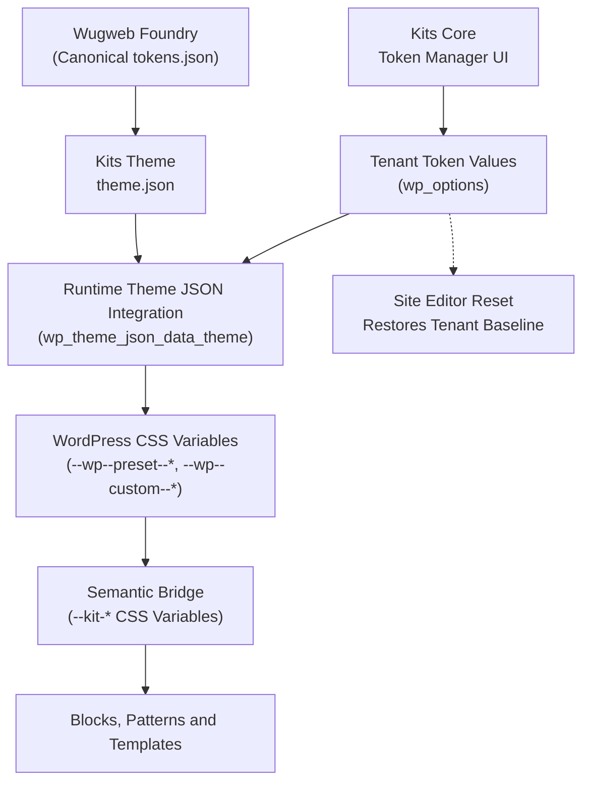
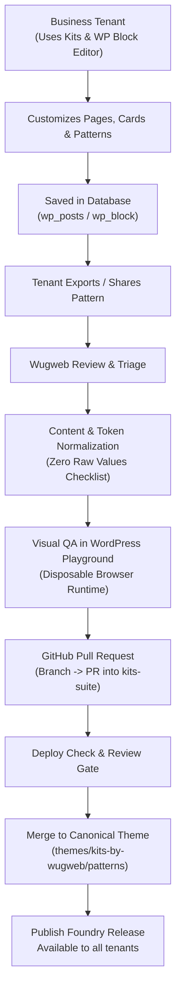
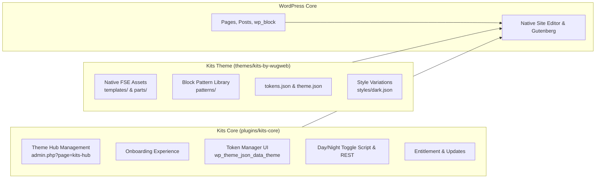

# Wugweb — Final Repository, Git, Packaging & WordPress Delivery Architecture

**Source boundary:** Wugweb Notion records, architecture discussions, and repository contracts.  
**Purpose:** Establish the canonical monorepo, product boundaries, Git workflow, build/package/release process, WordPress Playground previews, WordPress.org readiness, and the native-versus-plugin approach.

---

# 1. Repository Decision

## 1.1 One Wugweb Monorepo
The canonical development direction is one Git repository (`wugweb-git/kits`) for:
- WordPress plugins (`plugins/*`)
- Kits by Wugweb theme (`themes/kits-by-wugweb`)
- Design system and tokens (`packages/design-tokens`, `packages/design-system`)
- Shared packages (`packages/*`)
- Skills (`skills/*`)
- Agent instructions (`agents/*`)
- Documentation (`docs/*`)
- Build and release tooling (`tools/*`)
- Marketplace and distribution material (`marketplace/*`)
- GitHub Actions workflows (`.github/workflows/*`)

Each product retains its own independent code boundary, namespace, dependencies, version, build output, tests, and release process.

**One repository does not mean one product or one release.**

## 1.2 Repository Boundaries
The consolidated repository houses the development source of truth. Existing historical snapshots (such as legacy Brand OS foundation files) remain archived and preserved, not overwritten.

---

# 2. Final Repository Structure

```text
wugweb/ (https://github.com/wugweb-git/kits)
│
├── .github/
│   ├── workflows/
│   │   ├── ci.yml
│   │   ├── lint.yml
│   │   ├── test.yml
│   │   ├── build-theme.yml
│   │   ├── build-plugins.yml
│   │   ├── plugin-check.yml
│   │   ├── playground-preview.yml
│   │   └── release.yml
│   └── CODEOWNERS
│
├── plugins/
│   ├── kits-core/
│   │   ├── kits-core.php
│   │   ├── includes/
│   │   ├── src/
│   │   ├── build/
│   │   ├── assets/
│   │   ├── languages/
│   │   ├── readme.txt
│   │   ├── uninstall.php
│   │   └── composer.json
│   ├── sourceweb/
│   ├── insightweb/
│   ├── rankweb/
│   ├── directoryweb/
│   ├── mailweb/
│   └── planweb/
│
├── themes/
│   └── kits-by-wugweb/
│       ├── style.css
│       ├── theme.json
│       ├── functions.php
│       ├── templates/
│       ├── parts/
│       ├── patterns/
│       ├── styles/
│       ├── assets/
│       ├── tokens/
│       │   └── tokens.json
│       └── languages/
│
├── packages/
│   ├── design-tokens/
│   ├── design-system/
│   ├── shared-php/
│   ├── shared-js/
│   ├── admin-shell/
│   ├── rankweb-core/
│   ├── rankweb-shell/
│   ├── sourceweb-shell/
│   ├── insightweb-shell/
│   ├── mailweb-shell/
│   ├── planweb-shell/
│   └── automation-contracts/
│
├── skills/
│   ├── wordpress/
│   ├── design-system/
│   ├── frontend/
│   ├── accessibility/
│   ├── testing/
│   ├── security/
│   └── release/
│
├── agents/
│   ├── engineering/
│   ├── design/
│   ├── qa/
│   └── documentation/
│
├── tools/
│   ├── build/
│   ├── package/
│   ├── release/
│   ├── validate/
│   ├── tokens/
│   └── playground/
│
├── docs/
│   ├── architecture/
│   ├── decisions/
│   ├── design-system/
│   ├── plugins/
│   ├── theme/
│   ├── git/
│   ├── marketplace/
│   ├── deployment/
│   ├── testing/
│   └── release/
│
├── marketplace/
│   ├── theme/
│   ├── plugins/
│   ├── screenshots/
│   ├── banners/
│   ├── icons/
│   └── submission/
│
├── tests/
│   ├── integration/
│   ├── contracts/
│   └── shared/
│
├── package.json
├── pnpm-workspace.yaml
├── composer.json
└── README.md
```

## 2.1 Directory Responsibilities
| Directory | Responsibility |
|---|---|
| `plugins/` | Independently buildable WordPress plugins |
| `themes/` | Kits by Wugweb and its theme assets |
| `packages/` | Reusable code, shared contracts, and namespaced shells |
| `skills/` | Reusable task-specific skills |
| `agents/` | Agent instructions and role-specific workflows |
| `tools/` | Build, validation, packaging, and release scripts |
| `docs/` | Architecture, product, and engineering documentation |
| `marketplace/` | WordPress.org and commercial distribution assets |
| `tests/` | Shared, integration, and contract tests |
| `.github/workflows/` | CI, PR previews, packaging, and release automation |

## 2.2 Important Package & Bundling Rules
1. **Bundled-Code Model**: Shared code is bundled directly into each public plugin edition at build time. A public plugin must **never** depend at runtime on another Wugweb plugin simply because both live in the same monorepo.
2. **Namespaced Shell Per Plugin**:
   * `rankweb-shell`, `planweb-shell`, `sourceweb-shell`, `insightweb-shell`, `mailweb-shell`.
   * **Rule**: Do not use a global `kits-shell` handle across independently installed plugins. Each plugin bundles its own namespaced copy, injecting plugin-specific branding, endpoints, and navigation via configuration.
3. **`rankweb-core`**: Contains the 9 core SEO engine classes: Linker, Anchor, Silo, Link Audit, Video, Schema, Bulk, Redirects, Agent. Collision guards ensure multiple bundled copies coexist safely.
4. **External Services Registry**: Outbound network requests are centralized through `register_external_service(id, args)` and `remote_request(url, args, method)` using `wp_safe_remote_*`. All hosts must be disclosed in `== External services ==` in `readme.txt`.

---

# 3. GitHub & Git Workflow

## 3.1 Review & Merge Sequence
`Branch → PR → Review Gate → Owner Merge → Ship`

The review gate requires:
1. Code review using the code-review skill.
2. Review comments with file/line, severity, and fix.
3. Plugin audit when a plugin changes (`wp-plugin-audit`).
4. PHPCS on changed files.
5. Deploy check green.
6. Plugin Check for changed plugins.
7. Smoke test passing.
8. Codex review comments answered, fixed, or given a valid technical reason.
9. Review section in the PR description.
10. **Owner approval and merge** (no auto-merge).

## 3.2 Git Worktrees & Attribution
* **Worktrees**: Each session works in its own Git worktree for larger changes. Clean checkouts maintained; worktrees removed by exact path after merge.
* **Commit Attribution**: Must strictly use:
  ```text
  Co-Authored-By: Wugweb <admin@wugweb.com>
  ```
  *(No Claude or generic AI attribution lines).*

---

# 4. Build, ZIP Packaging & Distribution

## 4.1 Independent Packaging
Every plugin and the theme must produce its own independent, standalone distributable artifact:
* `dist/rankweb.zip`
* `dist/kits-core.zip`
* `dist/mailweb.zip`
* `dist/kits-by-wugweb.zip`

The monorepo **never** produces one combined WordPress ZIP containing every plugin.

## 4.2 Release Isolation
A commit or change to RankWeb must not automatically trigger a release of Kits Theme, MailWeb, or another product. Each product maintains its own:
- Independent version number
- Independent changelog
- Independent ZIP build
- Independent release decision and release tag

---

# 5. GitHub Actions & WordPress Playground

## 5.1 WordPress Playground PR Previews
Using `WordPress/action-wp-playground-pr-preview`:
1. Developer opens PR.
2. GitHub Actions packages the changed plugin/theme ZIPs.
3. A temporary, disposable WordPress Playground instance is initialized in the browser.
4. Blueprint configures the environment and activates the built ZIPs.
5. Reviewers inspect live block templates, patterns, and admin screens before merge.

---

# 6. WordPress.org Readiness Norms
Every public plugin edition follows the official WordPress Plugin Developer Handbook:
* **GPL License Only**: No trialware, no locked features, no hosted plugin bundling.
* **No Update URI**: `Update URI` removed for `.org` editions.
* **Requires Plugins**: Used strictly for dependencies hosted directly on WordPress.org.
* **External Services**: Full disclosure in `readme.txt` with privacy links and terms.
* **Naming**: Unique plugin-specific prefix (min 4 characters). Never use `aw_` or `aw-` in new code.
* **Security**: Nonces, capability checks, `wp_unslash()`, data sanitization, output escaping, and `$wpdb->prepare()`.

---

# 7. Native WordPress vs. Kits Core

| Layer | Responsibility | What Belongs Here |
|---|---|---|
| **Native WordPress (FSE)** | Visual styling, layout, content editing | Site Editor, Global Styles, Theme variations, Templates, Template Parts, Patterns, Typography/Palette presets. |
| **Kits Core** | Branded management & companion tools | Theme Hub, Page Options, Design-system index, Settings transfer (JSON export/import), Minimal Admin Shell, shared plugin navigation. |
| **Companion Plugins** | Domain-specific application logic | DirectoryWeb (Listings), RankWeb (SEO), MailWeb (Hostinger SDK & email), SourceWeb (Feeds), InsightWeb (Analytics), PlanWeb (Calendar). |

---

# 8. Admin UI Standard (Minimal UI)
* **Design Philosophy**: Modeled structurally on **Google Site Kit** (plugin dashboards) and **Uncode** (theme management).
* **Visual Palette**: Strict greyscale with a rare yellow accent (`#f59e0b` / `--kit-color-accent`).
* **Visual Data**: Inline SVG `MiniChart` primitive (no heavy Chart.js or external library dependencies).
* **Data Presentation**: Sortable, filterable tables with bulk actions, clear columns, pagination, and empty/loading states.

---

# 9. Product Naming Hierarchy

| Product Family | Full Name | Half Name | Initials |
|---|---|---|---|
| Standalone Plugin | SourceWeb | Source | SW |
| Standalone Plugin | InsightWeb | Insight | IW |
| Standalone Plugin | RankWeb | Rank | RW |
| Standalone Plugin | DirectoryWeb | Directory | DW |
| Standalone Plugin | MailWeb | Mail | MW |
| Standalone Plugin | PlanWeb | Plan | PW |
| Kits Suite | Kits Core | Core | KC |
| Kits Suite | Kits by Wugweb | Kits Theme | KT |

---

# 10. Phased Implementation Roadmap

* **Phase 0 — Inventory**: Audit existing repos, branches, and commits; preserve historical assets.
* **Phase 1 — Monorepo Foundation**: Establish root workspace, directories, README, CODEOWNERS, manifests.
* **Phase 2 — Shared Foundations**: `packages/design-tokens`, `packages/admin-shell`, Token Foundry tools.
* **Phase 3 — Product Packaging**: Independent ZIP builds, namespaced shells, bundled-code model.
* **Phase 4 — CI & Previews**: GitHub Actions for linting, Plugin Check, Playground previews.
* **Phase 5 — Marketplace Readiness**: Banners, icons, screenshots, POT files, external services disclosures.

---

# 11. Design-Token Architecture & Tenant-Level Visual Editing

## 11.1 Two Token Categories in `theme.json`

| Category | WordPress Location | Purpose | Generated CSS Variables |
|---|---|---|---|
| **Editor-Facing Presets** | `settings.color`<br>`settings.typography`<br>`settings.spacing` | Values exposed through native WordPress Site Editor controls | `--wp--preset--color--primary`<br>`--wp--preset--font-size--large`<br>`--wp--preset--spacing--medium` |
| **Custom Tokens** | `settings.custom` | Internal design variables such as blur, stroke, radius, and layout dimensions | `--wp--custom--radius--md`<br>`--wp--custom--blur--md`<br>`--wp--custom--stroke--default` |

### The Token Hierarchy Principle
$$\text{Primitive Tokens} \longrightarrow \text{Semantic Tokens} \longrightarrow \text{Component Styles} \longrightarrow \text{Patterns \& Templates}$$

Components and patterns reference stable semantic names (`--kit-color-accent`, `--wp--custom--radius--md`, `--wp--preset--color--primary`) instead of raw values, allowing global and tenant-specific theme re-styling without broken references.

## 11.2 Tenant-Level Visual Token Editing
A tenant must be able to change the value of any registered token without altering its identifier or breaking template references:

| Token Key | Foundry Default | Tenant Value Override | Status |
|---|---|---|---|
| `blur.md` | `8px` | `14px` | Stable identifier; value overridden |
| `stroke.default` | `1px` | `1.5px` | Stable identifier; value overridden |
| `radius.md` | `8px` | `12px` | Stable identifier; value overridden |
| `shadow.card` | Standard elevation | Custom elevation | Stable identifier; value overridden |

## 11.3 The "Reset to Tenant Baseline" Requirement
Standard Site Editor behavior resets styles back to the theme's hardcoded disk values. For a multi-tenant suite:
1. Foundry provides the original global baseline.
2. The tenant configures custom brand values through Kits Core's Token Customizer UI.
3. Tenant baseline values are saved in `wp_options` (`kits_brand_tokens`).
4. **Native Integration via `wp_theme_json_data_theme`**: Kits Core hooks into the native WordPress filter `wp_theme_json_data_theme` to merge tenant tokens directly into the theme's baseline data structure before user customizations are applied.
5. **Outcome**: When a site admin clicks "Reset" in the native WordPress Site Editor, the styles revert to the **tenant's configured baseline**, not the original Foundry defaults.

## 11.4 Token Flow Architecture



## 11.5 Visual Controls Gap Analysis
WordPress core provides partial native controls in Global Styles; Kits Core's visual manager bridges the missing capabilities:

| Token Type | Native Site Editor Support | Kits Core Requirement |
|---|---|---|
| **Colors** | Full native support | Native controls + semantic palette presets |
| **Typography** | Full native support | Native controls + curated font pairings |
| **Spacing** | Full native support | Native controls + section cadence tokens |
| **Shadows** | Partial preset selection | Custom preset elevation editor |
| **Stroke / Border Width** | Partial per-block | Dedicated global token sliders |
| **Border Radius** | Partial / block-dependent | Uniform card/control/media radius controls |
| **Blur / Backdrop** | No native token editor | Custom blur slider |
| **Layout Dimensions** | Limited content/wide widths | Exact content, wide, and break-out controls |

## 11.6 Design-System Terminology Distinction
Four distinct variable tiers coexist without collision:
* **`--wpds-*`**: WordPress Design System variables intended for Gutenberg editor chrome and wp-admin UI components.
* **`--wp--preset--*`**: WordPress theme presets generated by `theme.json` (palette, typography, spacing).
* **`--wp--custom--*`**: Custom theme variables defined in `settings.custom` (radius, stroke, blur).
* **`--kit-*`**: The semantic bridge variables consumed by Kits patterns, templates, and companion plugins (e.g. `--kit-radius-card: var(--wp--custom--radius--md, 8px);`).

## 11.7 The 10 Master Design-Token Requirements
1. **Canonical Foundry Token Registry**: Central source of truth in `tokens.json`.
2. **Primitive and Semantic Token Separation**: Raw primitives mapped to semantic roles.
3. **Stable Token Identifiers**: Zero breaking renames across product releases.
4. **Tenant-Specific Token Values**: Independent per-tenant styling without code modification.
5. **Visual Controls for Missing Native Types**: Sliders and pickers for blur, radius, stroke, elevation.
6. **Tenant-Specific Reset Baseline**: Filtered via `wp_theme_json_data_theme` so Site Editor resets to tenant values.
7. **Runtime WordPress theme.json Integration**: Zero file tampering on live filesystems.
8. **Universal Compatibility**: Blocks, patterns, and templates consume only semantic tokens.
9. **UI vs Theme Token Separation**: Admin chrome (`--wpds-*` / Minimal UI) isolated from front-end theme variables.
10. **Bidirectional Figma Sync**: Automated token parity between code repository and Figma design libraries.

---

# 12. Tenant Pattern Discovery & Upstream Contribution Pipeline

## 12.1 The Two-Way Foundry Flywheel
The Foundry operates not merely as a downstream distribution system, but as an active bidirectional flywheel:

$$\text{Downstream Distribution: } \text{Foundry} \longrightarrow \text{Theme / Plugin} \longrightarrow \text{Tenant Fleet}$$
$$\text{Upstream Contribution: } \text{Tenant Innovation} \longrightarrow \text{Extraction} \longrightarrow \text{Standardization} \longrightarrow \text{Foundry Canonical Release}$$

When a tenant creates or refines a high-performing block pattern, layout, or card module, that innovation can be selectively ingested, cleaned, standardized, and released to the entire multi-tenant network.

## 12.2 Where Tenant Changes Live (Storage Boundaries)
A critical engineering distinction: GitHub does **not** automatically see edits made inside the WordPress Block Editor.

| Asset Type | Storage Location | Ingestion / Export Requirement |
|---|---|---|
| **Page Content** | WordPress Database (`wp_posts`) | Export block markup from post content |
| **Synced Patterns** | Database (`wp_block` post type) | Export JSON / copy reusable pattern markup |
| **Theme Templates** | Filesystem or Database (`wp_template`) | Diff database customization against theme file |
| **Global Styles** | Database (`wp_global_styles`) | Export `wp_theme_json_data_theme` / user styles |
| **Theme & Plugin Source** | Git Repository (`wugweb-git/kits`) | Canonical Git commits and Pull Requests |

## 12.3 Tenant-to-Foundry Workflow



## 12.4 Three Pattern Extraction Methods
1. **JSON Export**: Exporting individual saved pattern definitions directly from WordPress (`wp_block`).
2. **Block Markup Copying**: Extracting clean block HTML grammar (`<!-- wp:... /-->`) directly from the code editor view.
3. **Theme-File Extraction**: Diffing modified tenant template files against the upstream repository source.

## 12.5 Pre-Promotion Standardization Checklist
Before any tenant pattern is merged into the canonical Foundry library, it must pass this gate:
- [ ] **Media Sanitation**: Remove tenant-specific images/videos; replace with neutral SVG placeholders or open Kits assets.
- [ ] **Content Neutralization**: Remove proprietary tenant copy, brand names, and localized phone numbers.
- [ ] **CSS Purification**: Remove ad-hoc `<style>` tags or inline style attributes.
- [ ] **Token Alignment**: Replace all hardcoded hex colors, pixel margins, and raw font declarations with semantic `--kit-*` tokens.
- [ ] **IP & Licensing Verification**: Ensure explicit customer consent and GPL compatibility.

## 12.6 Visual Development & QA via WordPress Playground
WordPress Playground (`https://wordpress.org/playground/`) serves as the disposable runtime for pattern testing and PR previews:
* **PR Previews**: GitHub Action `WordPress/action-wp-playground-pr-preview` boots a temporary WordPress instance per PR with candidate patterns installed.
* **Blueprint Configuration**: Automatically activates the Kits theme, companion plugins, and loads tenant-contributed patterns for visual inspection.
* **Review Boundary**: Playground allows zero-cost visual regression testing without needing dedicated permanent staging servers for every review.

## 12.7 Architectural Corrections & Guardrails
* **No `Create Block Theme` Dependency**: The `Create Block Theme` plugin is rejected as a universal extraction mechanism. Extraction must use direct, predictable file/markup diffing.
* **Synced vs Unsynced Distinction**: Only synced patterns live in `wp_block`; unsynced patterns live inline inside page HTML.
* **Playground vs Staging**: Playground is for disposable, browser-based visual verification; permanent staging environments (`staging.animalwrites.in`) remain reserved for end-to-end integration and cron/email validation.

---

# 13. FSE Customer Interaction Model, Theme Hub & Day/Night Architecture

## 13.1 Complete Four-Tier Customer Interaction Model

| Touchpoint | Purpose | Customer Action |
|---|---|---|
| **Pages & Posts** | Build individual content URLs | Create native pages (`/about`, `/pricing`, `/contact`) and insert block patterns |
| **Site Editor** | Control site-wide structure | Edit global headers, footers, query loops, and template hierarchies |
| **Global Styles** | Control the visual system | Tune colors, typography scale, spacing, and select style variations |
| **Wugweb Theme Hub** | Access Kits operational suite | Complete onboarding wizard, discover components, configure tokens, licensing |

### Clear Boundary: Pages vs. Central Management
* **Pages**: Individual URL endpoints and post content. FSE does **not** replace standard WordPress Pages and Posts.
* **Templates**: Reusable layout shells housing dynamic blocks (`core/post-content`, `core/post-title`).
* **Patterns**: Curated, responsive section modules.
* **Styles**: Global design token configurations (`theme.json`).
* **Theme Hub**: Branded administrative entry point in wp-admin (`admin.php?page=kits-hub`) that connects and accelerates these capabilities without replacing the native Site Editor.

## 13.2 Day/Night Runtime Architecture
A visitor-facing dark mode toggle and an editor-level style variation are two fundamentally different architectural concerns:

| Feature Layer | Architectural Mechanism | Purpose |
|---|---|---|
| **Editor Style Variation** | `themes/kits-by-wugweb/styles/dark.json` | An editorial design choice for customers who desire a permanently dark website. |
| **Visitor Runtime Toggle** | Lightweight script / WP Interactivity API | A live interactive toggle in the header enabling visitors to switch modes on the fly. |

### Technical Implementation Pillars:
1. **Semantic Color Tokens in `theme.json`**:
   Backgrounds and inks use semantic tokens (`--kit-color-bg`, `--kit-color-ink`, `--kit-color-raised`, `--kit-color-line`) that resolve appropriately in both light and dark modes.
2. **Early `wp_head` Anti-FOUC Script**:
   Inline, blocking micro-script in `<head>` evaluating `localStorage.getItem('kit_theme_mode')` or system `window.matchMedia('(prefers-color-scheme: dark)')` to immediately apply `data-theme="dark"` before DOM rendering, preventing flash of unstyled content.
3. **CSS Custom Property Shift**:
   `[data-theme="dark"]` shifts the underlying semantic variables without rewriting component styles.

## 13.3 Architectural Separation of Ownership



* **Theme Ownership (`kits-by-wugweb`)**: Pure presentation, template parts (header, footer), block patterns, styles, `theme.json`, and style variations.
* **Plugin Ownership (`kits-core`)**: Administrative management, Theme Hub, onboarding wizard, Day/Night script injection, token manager UI, and licensing.
* **Editing Canvas**: The native WordPress Site Editor is the sole editing canvas. Kits Core never duplicates native Site Editor controls without an explicit technical gap.

---

# 14. Consolidated Technical Audit, Architectural Boundaries & Security Safeguards

## 14.1 The Three Distinct Layers
The ecosystem strictly separates responsibilities into three isolated layers:

| Layer | Primary Responsibility | Repository Placement | Allowed Content | Strict Prohibitions |
|---|---|---|---|---|
| **Foundry** | Master design tokens, approved patterns, Storybook builds, visual QA, schemas | `packages/design-tokens`<br>`packages/design-system` | `tokens.json`, semantic mappings, build scripts, Storybook | Zero WordPress runtime dependencies; zero customer data |
| **Theme** | Pure visual presentation, layout templates, template parts, global styles | `themes/kits-by-wugweb` | `style.css`, `theme.json`, `templates/`, `parts/`, `patterns/`, `styles/*.json` | **Zero business logic**, zero cloud sync, zero custom admin screens, zero silent plugin installers |
| **Companion Plugin** | Admin UI, onboarding, licensing, token management, cloud sync, durable custom blocks | `plugins/kits-core` | `admin/theme-hub/`, onboarding wizard, licensing endpoints, REST APIs | Must not duplicate native Site Editor controls where WordPress core already provides them |

### Foundry-to-WordPress Data Flow
$$\text{Foundry (tokens.json, patterns, manifests)} \longrightarrow \text{Cloudflare R2 / Release Bundles} \longrightarrow \text{Kits Core Plugin} \longrightarrow \text{WordPress Site Editor} \longrightarrow \text{Kits Theme} \longrightarrow \text{Rendered Site}$$

---

## 14.2 The Four-Phase Customer Onboarding Journey
The onboarding flow is designed to showcase high design fidelity without resorting to generic plugin installation wizards or forced redirects.

### Phase 1 — Purchase & Store Handoff
* Store confirmation displays theme download ZIP, license key with 1-click copy, and 3-step installation guide.
* Welcome email dispatches download link, license key, invoice, and quick-start docs.

### Phase 2 — WordPress Installation & Safe Activation
* Customer installs and activates `kits-by-wugweb`.
* **Guardrail**: **Zero activation hijacking**. The theme presents a clean, dismissible admin notice with a button to begin setup or install `kits-core`. Forcibly redirecting users upon theme activation is strictly banned for WordPress.org compliance.

### Phase 3 — Four-Step Tailored Onboarding Wizard (inside `kits-core`)
1. **Step 1: Brand & License Verification**: Enter license key, validate entitlement, connect to Foundry, explain unlocked assets.
2. **Step 2: Design System & Starter Architecture**: Select curated design preset, choose starter pages, select pattern bundle, optionally import placeholder media, apply selected theme style variation.
3. **Step 3: Brand Customization**: Upload logo, configure primary/accent colors, select typography pairing, live preview.
4. **Step 4: Theme Hub Launch**: Review imported assets, manage headers/footers, and link to the native Site Editor.

### Phase 4 — Ongoing Experience in Theme Hub
Theme Hub (`admin.php?page=kits-hub` under Appearance via `add_theme_page()`) serves as the permanent administrative dashboard:
* Component and block pattern library.
* Design system and visual token manager.
* Starter layouts and page creation shortcuts.
* Header and footer management.
* License and Foundry synchronization controls.

---

## 14.3 Technical Audit & Debunked Misconceptions
The architecture explicitly corrects several misleading implementation claims:

| Incorrect or Misleading Claim | Architectural Correction & Official Standard |
|---|---|
| **"Put the custom React wizard & Theme Hub in the theme."** | **REJECTED**: Theme admin screens must not contain heavy React applications or custom business logic. WordPress.org classifies custom management as plugin territory. Theme Hub lives exclusively in `kits-core`. |
| **"Themes can silently install their companion plugin."** | **REJECTED**: Themes submitted to WordPress.org cannot bundle or silently auto-install plugins. Must be a dismissible recommendation notice with explicit user action. |
| **"Updating `wp_global_styles` is the normal way to apply style variations."** | **REJECTED**: Too simplistic and risks database corruption. Theme style variations are declarative JSON files under `/styles/*.json`. Direct database writes are avoided. |
| **"Filtering `wp_theme_json_data_user` prevents database overrides."** | **REJECTED**: The filter modifies user-level data at runtime, but does not stop users from saving changes in the Site Editor and risks overriding user choices destructively. |
| **"`custom: false` and `defaultPalette: false` lock down the entire editor."** | **REJECTED**: These only control specific color customization controls; they do not lock the entire Gutenberg editor. |
| **"Everything can live in the theme because FSE supports it."** | **REJECTED**: FSE does not erase the boundary between presentation (theme) and durable functionality/blocks (plugin). |
| **"Zero database bloat because pages use pattern references."** | **REJECTED**: Pages and synced patterns still create database records in `wp_posts` and `wp_block`. Do not claim zero database footprint. |

---

## 14.4 Security & Operational Safeguards

| Operational Risk | Mandatory Architectural Safeguard |
|---|---|
| **GitHub Credentials Exposed** | **Never ship Foundry write tokens or GitHub personal access tokens in the plugin.** |
| **Unauthorized Submissions** | Per-installation authentication, tenant-scoped API keys, and server-side validation. |
| **Malicious Block Markup** | Strict server-side HTML/block sanitization; human/automated code review before publishing to the Foundry. |
| **Stale Pattern Manifests** | Versioned manifests, explicit cache expirations (`set_transient`), and manual cache-invalidation actions. |
| **Tenant Data Leakage** | Strict tenant-scoped authorization and isolated configuration payloads. |
| **Remote Service Outage** | **Graceful fallback**: Theme and plugin must remain 100% operational using local cached patterns and local theme assets if the Cloudflare relay or Foundry is offline. |
| **Plugin/Theme Version Mismatch** | Explicit compatibility declarations (`Requires Plugins`, minimum theme version checks) and migration scripts. |
| **Theme Switching** | Keep all durable business functionality, custom post types, and custom block definitions in `kits-core` so content survives a theme switch. |

---

## 14.5 Contradiction Resolutions Across Architecture Discussions

| Topic | Earlier Misalignment | Resolved Official Architecture |
|---|---|---|
| **Theme Logic** | React wizard inside theme | **Zero-code declarative theme**. Custom UI and logic belong exclusively in `kits-core`. |
| **Theme Admin** | Theme creates admin menus | **Plugin owns Theme Hub** under Appearance via `add_theme_page()`. |
| **Plugin Installation** | Silent auto-installation | **Separate installation** triggered by explicit user action via dismissible notice. |
| **Design Tokens** | Writing directly to DB | **Foundry is source of truth**; theme exposes `theme.json`; plugin injects overrides via `wp_theme_json_data_theme`. |
| **Pattern Delivery** | Cloud-only vs Theme-only | **Hybrid**: Local default patterns bundled in theme; optional/new patterns delivered via versioned manifests. |
| **Global Styles** | Rigid editor lock down | **Defined boundaries**: Defaults defined by theme, tenant baselines injected via filter, native Site Editor remains editable. |
| **Day / Night** | Style variation vs Toggle | **Separate layers**: `styles/dark.json` is a design variation; runtime toggle is a visitor-facing script. |
| **Onboarding Flow** | Aggressive activation redirect | **Controlled, guided entry point** via clean admin notice; zero activation hijacking. |


